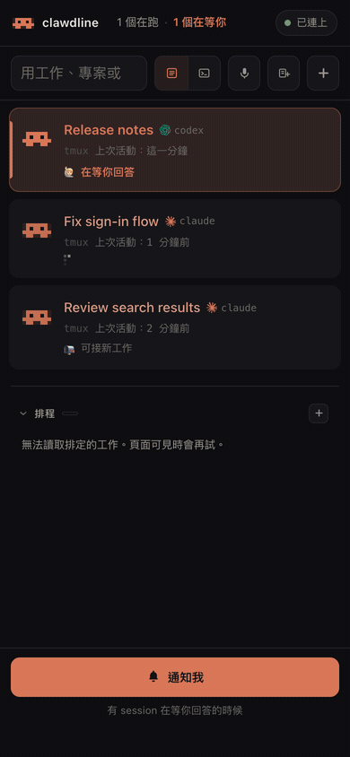
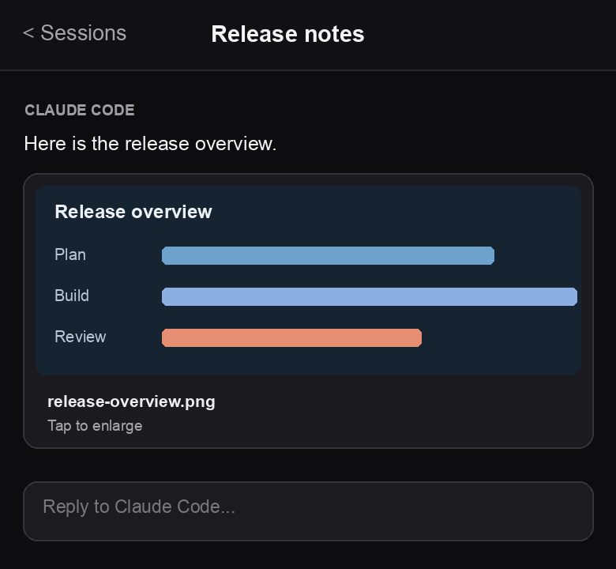

# Clawdline

[繁體中文](README.zh-TW.md)

[](LICENSE)
[](go.mod)

**See which Claude Code and Codex Sessions need you, then open one to respond or leave a to-do.**

Illustrative demo based on the console:





## What you can do

- **Follow Sessions:** See what is working or waiting, read the conversation, view pictures from Agents, and reply with text, voice, or a marked-up picture. [Sessions](docs/user/sessions.md)
- **Keep work moving:** Leave [to-dos](docs/user/board.md#session-to-dos), answer [Agent notes](docs/user/sessions.md#attention-notes-from-agents), and get [notifications](docs/user/notifications.md).
- **Work in a terminal:** Open a live [terminal](https://clawdline.com/docs/shells/#terminals) beside your Sessions.
- **Delegate and track delivery:** [Dispatch](docs/user/clawdfather-and-dispatch.md) to another Session, verify that its work landed, and follow larger work on the optional [Board](docs/user/board.md).
- **Run work later:** Queue long commands with [callbacks](docs/user/clawdfather-and-dispatch.md#callbacks-for-long-commands) or start tasks with [schedules](docs/user/schedules.md). Cloud Pro adds webhook triggers.
- **Bring your projects together:** [Register projects](docs/user/projects.md), share rules and skills across Claude Code and Codex with [unify](docs/project-files.md#unify), and see [usage](docs/user/usage.md).
- **Use another device:** Open the console through [remote access](docs/user/remote-access.md), including optional end-to-end encrypted Clawdline Cloud.

Clawdline runs the daemon and console on your machine and works with Claude Code and Codex Sessions you already use. Cloud is optional; its relay carries encrypted data. [How it works](docs/architecture.md)

## Install

On macOS 13+ or Linux, install Claude Code or Codex, then run:

```sh
curl -fsSL https://raw.githubusercontent.com/sainteye/clawdline/main/install.sh | sh
```

The installer verifies the release, starts a per-user service, and opens the console. Start a Session there or run `claude` or `codex` in tmux; the release includes tmux if needed. [Install and first run](docs/user/install.md) · [First Session](docs/user/first-session.md)

## Availability

- Local use is free and needs no Clawdline account. Cloud offers Free and Pro plans.
- Windows runs the daemon and console but cannot yet list Sessions or open terminals. [Platforms](docs/user/platforms.md)
- This is a pre-1.0 release; features may change. The console supports nine languages, with English fallback for newer untranslated copy. [Localization](docs/localization.md)

## Guides

[User guide](docs/user/README.md) · [Agent guide](docs/agent-contract.md) · [Build from source](docs/user/install.md) · [Troubleshooting](docs/user/troubleshooting.md) · [Developer docs](docs/README.md)

## License

[MIT](LICENSE)
