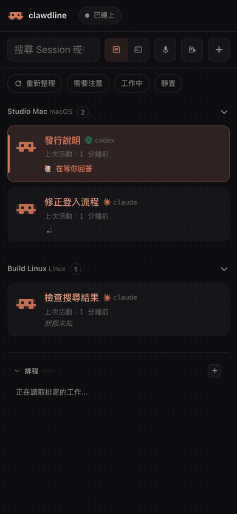
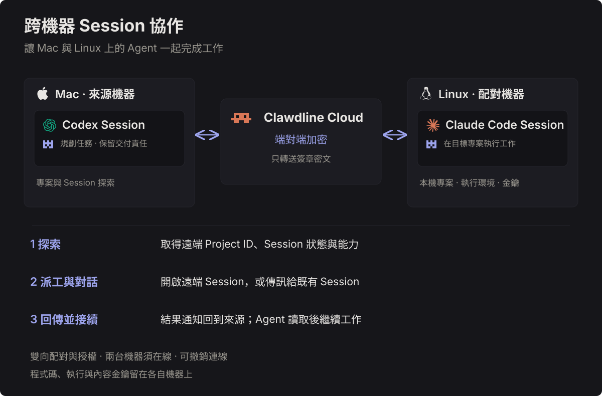
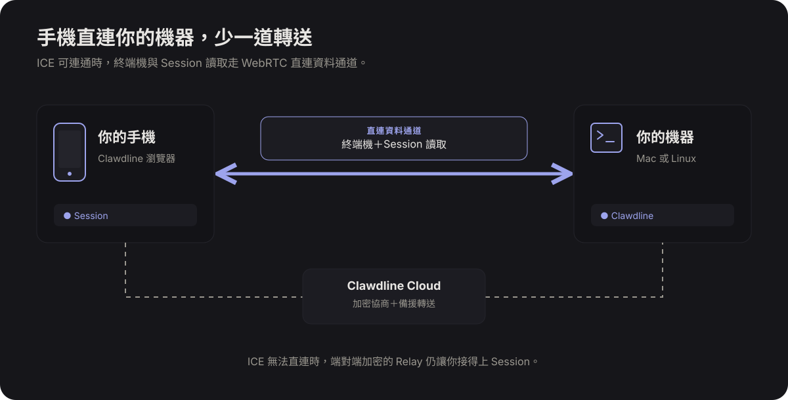

# Clawdline

[English](README.md)・[安全性](https://clawdline.com/security/)

[](LICENSE)
[](go.mod)

**透過 Clawdline Cloud，在手機同一份清單查看多台機器的 Claude Code 和 Codex Session，點開就能回覆或留待辦。**

使用示意資料錄製的真實主控台連續操作：



[Herdr](https://github.com/herdrdev/herdr/blob/master/docs/versions/0.9.1/website/src/content/docs/connecting-machines.mdx) 也能在 SSH 的 TUI 視窗列出多台機器的 Agent；[T3 Code](https://github.com/pingdotgg/t3code/blob/main/docs/user/remote-access.md) 可連接多個環境。Clawdline Cloud 則在手機瀏覽器將 Session 依機器列在同一頁，並直接開啟對話、待辦與圖片。

## 你可以做什麼

- **掌握 Session：** 看誰在工作、誰在等你；讀取對話、查看 Agent 傳來的圖片，用文字、語音或標註過的圖片回覆。[Session](docs/user/sessions.md)
- **讓工作接著走：** 留下[待辦](docs/user/board.md#session-to-dos)、回答 [Agent 便條紙](docs/user/sessions.md#attention-notes-from-agents)，並接收[通知](docs/user/notifications.md)。
- **操作終端機：** 在 Session 旁開啟即時[終端機](https://clawdline.com/docs/shells/#terminals)。
- **派工並追蹤交付：** [派給](docs/user/clawdfather-and-dispatch.md)另一個 Session、確認成果已合併，用選用的[看板](docs/user/board.md)追蹤較大的工作。
- **稍後執行：** 用 [Callback](docs/user/clawdfather-and-dispatch.md#callbacks-for-long-commands) 排入耗時命令，或用[排程](docs/user/schedules.md)啟動任務；Cloud Pro 可用 Webhook 觸發。
- **整理專案：** [登錄專案](docs/user/projects.md)、透過 [unify](docs/project-files.md#unify) 讓 Claude Code 和 Codex 共用規則與 skill，並查看[用量](docs/user/usage.md)。
- **掌握每台機器：** [Clawdline Cloud](docs/user/remote-access.md) 在手機彙整多台機器的 Session，透過端對端加密中繼連線。
- **手機直連機器：** ICE 可連通時，即時終端機與 Session 讀取改走 WebRTC 直連資料通道；直連失敗時仍可用加密 Relay。[Cloud 連線](docs/cloud.md)

Clawdline 的常駐服務與主控台在你的機器上執行，管理你已使用的 Claude Code 和 Codex Session。Cloud 是選用功能；中繼只傳送密文。[運作方式](docs/architecture.md)

## 跨機器 Session 協作（Cloud）

讓 Mac 上的 Codex 與 Linux 上的 Claude Code 接力工作。雙向配對後，Agent 可探索遠端 Project 與 Session、把任務派到指定專案、與既有 Session 互傳訊息，並在結果回來時接續工作；不必由你複製指示與回覆。



兩台機器都需在線並授權互通；工作在目標機器執行，程式碼與內容金鑰留在各自機器上。配對可撤銷，派工完成不代表變更已合併。**目前提供於 dev 版本**；正式版的一行安裝尚未包含這次新增的探索與 Session 喚醒功能。[使用方式與權限界線](docs/remote-agent-work.md)

## 手機直連你的機器（Cloud）

手機完成配對後，Clawdline 會嘗試與 Mac 或 Linux 機器建立 WebRTC 直連資料通道，讓即時終端機與 Session 讀取少經過一次 Relay 轉送，操作反應可以更快。Cloud 仍負責連線協商及其他指令；ICE 無法直連時，讀取會改走端對端加密的 Relay。



可以在機器的「設定 → 遠端」或執行 `clawdline cloud direct off` 關閉直連。AWS Linux 可把 ICE 固定在單一 UDP 埠；請看 [Cloud 設定說明](docs/cloud.md#aws-linux-direct-connection)與[完整 Linux 步驟](docs/linux.md#let-a-cloud-browser-connect-directly-to-ec2)。固定埠設定目前提供於開發版本。

## 安全性與你的資料

**[查看安全性說明：加密、配對，以及 Cloud 能看見什麼](https://clawdline.com/security/)。** 頁面包含資料流圖解，以及各步驟對應的原始碼連結。

**本機讀取與 Cloud 上傳是兩件事：** Clawdline 在你的機器讀取對話；啟用 Cloud 時，內容在本機加密後才傳送，Cloud 轉送密文、不持有內容解密金鑰。你的機器與已授權的配對瀏覽器可以讀取內容。

查看 Clawdline、Herdr、T3 Code 與 Orca 的 [AI 資安檢視比較](https://clawdline.com/zh-TW/ai-review/)：兩種英文題目、固定原始碼版本，以及 Claude Code／Codex 的完整原始回覆。

- **在你的機器上：** Clawdline 會讀取既有的 Claude Code、Codex 紀錄、終端畫面，以及功能所需的專案檔案。對話或終端中已有的敏感內容可能顯示在主控台。本機服務預設只監聽 loopback；本機使用不需要 Clawdline 帳號。
- **未啟用 Cloud：** Cloud 連線預設關閉。更新檢查仍可能連到 GitHub 或官網版本端點；關閉 Cloud 不代表停用所有網路流量。
- **啟用 Cloud 後：** Session 快照會自動發布；開啟對話、檔案與附件時，會向你的機器請求內容。內容在本機加密後才傳送，不會因此將整份對話歷史封存備份到 Cloud。內容金鑰由機器與配對瀏覽器持有；Cloud 轉送密文，沒有內容解密金鑰。服務仍可見帳號、裝置、路由、時間與流量資訊。
- **誰能操作：** 直接配對的瀏覽器可讀取與傳送；Cloud 另有每台機器的操作開關。傳送指示或操作終端可能在你的機器上執行程式，請只配對你信任的裝置。撤銷無法抹除已讀內容；你的電腦、配對瀏覽器及其載入的網頁程式仍是信任邊界的一部分。
- **你的 AI 供應商：** Claude Code 與 Codex 仍會依各自供應商的政策傳送 AI 請求。Clawdline 的加密 Cloud 通道不會改變這項關係。

[遠端存取與權限](docs/user/remote-access.md)・[加密實作](docs/cloud.md)・[安裝與更新的信任基礎](docs/releasing.md#what-a-release-is)

## 安裝

在 macOS 13 以上或 Linux，先安裝 Claude Code 或 Codex、受信任的 Python 3 與 OpenSSL 3 以上版本。macOS 內建的 LibreSSL 不足以驗證；請看[驗證工具需求](docs/user/install.md#before-you-start)。接著執行：

```sh
curl --proto '=https' --proto-redir '=https' -fL \
  https://raw.githubusercontent.com/sainteye/clawdline/74fc07e5bc8c8d092f216478f26d99b7ed1b77ee/install.sh \
  -o clawdline-install.sh
```

先查看下載的腳本，確認內容後再執行：

```sh
sh ./clawdline-install.sh --version v2.1.2
```

安裝腳本會先用本機 OpenSSL，對照已審查腳本內固定的公鑰驗證 manifest 簽章，再核對已簽署的壓縮檔大小與 SHA-256；通過後才解壓縮、執行下載的程式。缺少驗證工具或檢查失敗都會停止安裝。你仍須信任安裝腳本與本機工具；驗證通過的程式才會啟動使用者服務並開啟主控台。你可以從主控台開 Session，或在 tmux 執行 `claude` 或 `codex`；需要時可用發行版內附的 tmux。[安裝與首次使用](docs/user/install.md)・[第一個 Session](docs/user/first-session.md)

以上步驟同時固定**驗簽腳本**與 `v2.1.2` 發行版。腳本版本與安裝程式的版本是兩個獨立來源；已簽署的發行 manifest 會標明程式的原始碼版本。安裝器不會默默改裝最新發行版。[先審查再固定版本安裝](docs/user/install.md#review-and-pin-an-installation)說明操作方式與首次安裝的信任邊界。

## 支援範圍

- 本機功能免費，不需要 Clawdline 帳號；Cloud 有 Free 與 Pro 方案。
- Windows 可執行常駐服務與主控台，但目前不能列出 Session 或開終端機。[平台](docs/user/platforms.md)
- 1.0 起，macOS 與 Linux 的正式安裝版可直接更新。主控台支援九種語言；新文案尚無翻譯時會顯示英文。[更新方式](docs/updates.md)・[語系機制](docs/localization.md)

## 指南

[使用指南](docs/user/README.md)・[Agent 指南](docs/agent-contract.md)・[從原始碼建置](docs/user/install.md)・[疑難排解](docs/user/troubleshooting.md)・[開發文件](docs/README.md)・[UI 動畫編號表](docs/ui-motion-catalog.md)・[靜態 HTML 成果頁](docs/html-artifacts.md)

使用指南目前只有英文版。

## 授權

[MIT](LICENSE)
